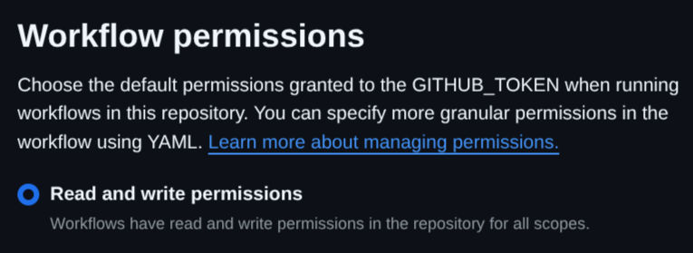

# Background

In order to ensure I stand out amongst an endless sea of Microsoft Word based resumes (and certainly not at all because Microsoft Word isn't available on Linux), I have crafted my resume in LaTeX. Aside from benefiting from source control via Git, it appeals to the part of my brain that values uniqueness.

One drawback, however, is that if I both update my resume and want it to be available to download somewhere, like on this website or LinkedIn, I need to both recompile and reupload it. Generally, this isn't a ton of work (I mean how often does one update their resume), but as a software developer, I see any repetitive work as something that can be automated. The solution? *Continuous Deployment*.

# Setting up Continuous Deployment

Since my resume's source is hosted on GitHub, I can leverage GitHub actions (tooling that enables CI/CD and automation, an equivalent for which should also be available on most other Git hosts), to compile and upload the resulting PDF to a release whenever a change is made to the main branch. The location where it will be uploaded to is just a file in a release, which I can then link to.

Fortunately, this can be accomplished pretty easily, as our post-merge pipeline is a simple two step workflow:
1. Compile the resume into a PDF
2. Upload the PDF to a release

In practice, this was accomplished by creating the following `build.yml` file in the `.github` directory of my resume's repo:
```yml
name: build resume

on:
  push:

jobs:
  build:
    runs-on: ubuntu-latest
    steps:
    - uses: actions/checkout@v4
    - uses: cachix/install-nix-action@v31
      with:
        github_access_token: ${{ secrets.GITHUB_TOKEN }}
    - run: nix flake check
    - run: nix build
    - uses: svenstaro/upload-release-action@v2
      with:
        repo_token: ${{ secrets.GITHUB_TOKEN }}
        file: result/resume.pdf
        asset_name: resume.pdf
        tag: release
        overwrite: true
        body: "Latest version of William McKinnon's resume"
```

Prior to running this action, I needed to grant GitHub actions write permissions to the resume repo, otherwise it wouldn't be able to update the release. I found this setting in Settings / Actions / General / Workflow Permissions:



# Conclusion
As simple as that, updating my resume now requires no additional work beyond the textual update itself (like most sane people)! Beyond this process, I've also added a step in the release workflow to create a `.png` copy of my resume as well, so that it can be seen in all of its glory in the README of its own repo, as well as on this site. This image will always be up to date (aside whatever media caching your web browser of choice implements), as it links to the `.png` file in the release:


With all of this flexing of my resume, I figure I owe you a look at it. Be gentle in the comments! :)

